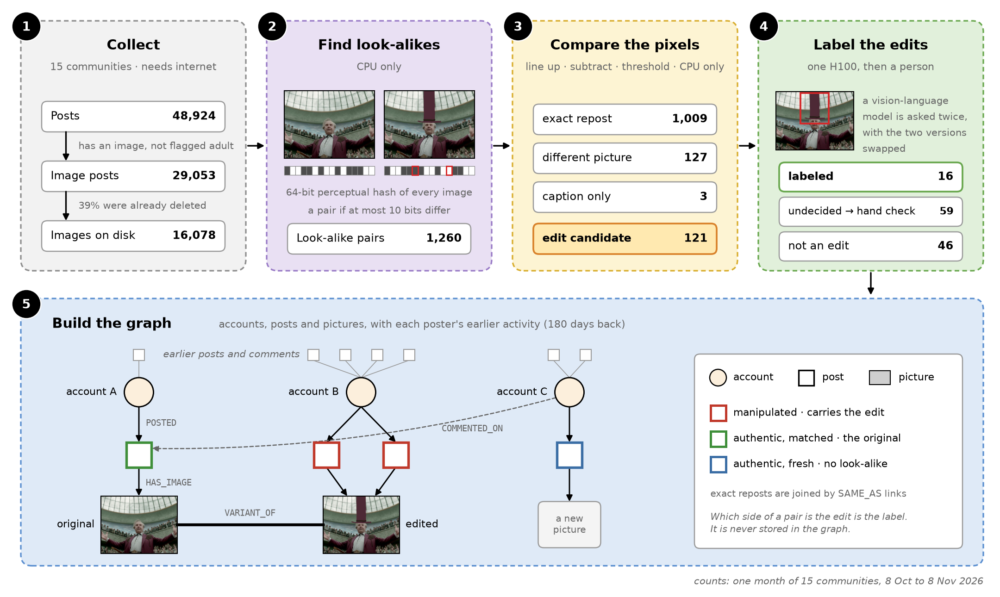
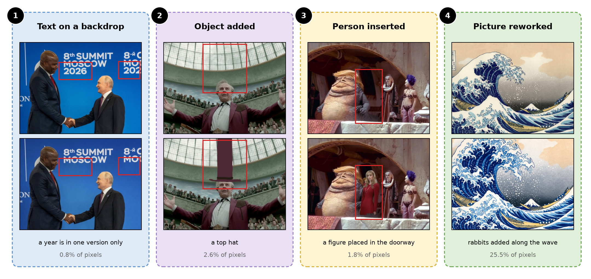
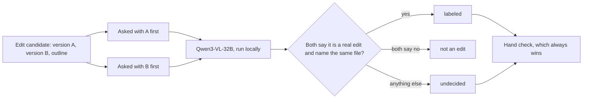
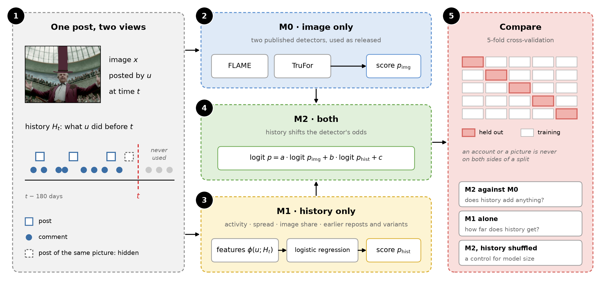
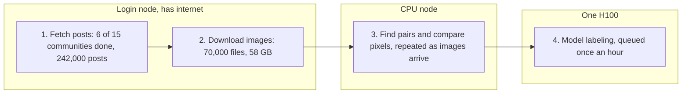

# Beyond the Pixels

**How much does social context add to image manipulation detection at posting time?**

Team Mozar: Mohammed Ansari, Lazar Cankovic. Course project (CS176), aiming at a workshop paper.
Status on 15 November 2026: data collection is running, labels exist for the first month, no model results yet.

## Abstract

Detectors of manipulated images look only at pixels, yet the images that matter are posted by accounts with
histories. We ask how much that history is worth at the moment a post goes up. No existing dataset pairs
verified manipulation labels with real social context, so we build one from Reddit. We find pairs of images
where one is a local edit of the other, a vision-language model and a hand check decide which of the two is
the edit, and every post carrying the edited image becomes a positive. These posts are compared with posts
carrying the unedited original and with ordinary posts of never-before-seen images. Holding out users and
pictures, we compare two published forensic detectors (FLAME, TruFor), the poster's history alone, and both
together. Results are not in yet; this repository holds the pipeline, a data sample and the plan.

## Why

- Forensic detectors are weak on real platform images. FLAME, the strongest published localizer, averages
  0.46 pixel-F1 on editing tools it has not seen.
- A post does not arrive alone. The account has posted before, and the picture has often been on the platform
  already. None of that is used by a pixel-only detector.
- Existing datasets with social context label posts by the community they came from, so a model can read the
  label from metadata. We need labels that come from the image itself.

The full argument, related work and experiment plan are in [docs/proposal.md](docs/proposal.md).

## The pipeline



The counts in the figure are from the first month of data.

### 1. Posts and images

`collect.py posts` pages through the [Arctic Shift](https://arctic-shift.photon-reddit.com) archive for each
community in `config.py` and saves every post. `collect.py images` downloads each distinct image once. Posts
flagged as adult are skipped and their images are never downloaded. About 40% of image links are already dead
when we reach them, because the post was deleted or removed.

### 2. Finding pairs

We want two posts that carry the same picture, where one version has been altered.

1. **Look-alikes.** Every image gets a 64-bit perceptual hash. Two images are look-alikes if their hashes
   differ in at most 10 bits. An image that matches more than ten others is a meme template and is dropped.
2. **Pixel comparison.** The second image is lined up on the first (ORB keypoints, RANSAC homography), both are
   blurred slightly, and they are subtracted. The share of pixels that changed decides the kind of pair:

| Kind | Rule | What happens |
|---|---|---|
| Exact repost | under 0.5% changed | kept as a "same picture" link in the graph |
| Caption only | a wide band touching the top or bottom edge | set aside |
| Different picture | over 40% changed, or the two cannot be aligned | discarded |
| **Edit candidate** | anything else | sent to the labeling model |

**Four real pairs from the data.** In each column the two pictures are the two versions, and the red boxes
are drawn by the pipeline where they differ.



1. **Text on a backdrop.** A news-style photo of a handshake at a summit. One version carries the year and the
   other does not. Three accounts posted it within 18 hours. Which version is the original is not settled:
   the labeling model says the year was added, and the version without it was posted last and removed by
   moderators. The pair is on the hand-check list.
2. **Object added.** A film still with a top hat put on the man's head. The model named the hat version in
   both orders.
3. **Person inserted.** A figure placed in the doorway of a film scene. The model agreed it was an edit but
   named a different file in each order, so the pair waits for the hand check.
4. **Picture reworked.** A print of *The Great Wave* with rabbits added along the wave, posted ten hours after
   the original. The hashes differ in 8 of 64 bits and the images line up on 140 matched points.

### 3. Labeling with a vision-language model

Pixels tell us that two versions differ, not which one is the edit. Posting order does not settle it either:
in one pair the watermarked copy was posted first and the clean one later.



The model answers five questions as JSON: is this a change to the picture's content, which version was
altered, what visible trace shows it, does it look AI-made, and how confident it is. It sees only the images.
It never sees dates, usernames, titles or communities. Asking twice with the order swapped catches a model
that favours whichever image comes first.

For the Great Wave pair, both answers named the rabbit version:

> "Image 2 contains numerous white rabbits riding the wave, which are not present in Image 1 and do not blend
> with the original artwork's style or content."

A person then checks the pairs in `data/pairs/review.html` and writes verdicts in
`data/labels/hand_check.csv`. `collect.py index` turns the decisions into the dataset table:

| Label | Meaning |
|---|---|
| `manipulated` | the post carries the edited version |
| `authentic_matched` | the post carries the unedited original of a labeled pair |
| `authentic_fresh` | an ordinary post whose image has no look-alike at all (three per manipulated post) |

### 4. Building the graph

`graph.py histories` fetches what each poster in the dataset did in the 180 days before their post.
`graph.py graph` writes two plain tables, `nodes.csv` and `links.csv`, which also load into Neo4j as they are.

Panel 5 of the figure at the top shows the result: accounts, posts and pictures, joined by `POSTED`,
`HAS_IMAGE`, `COMMENTED_ON`, `CROSSPOSTED`, `SAME_AS` (exact repost) and `VARIANT_OF` (one is an edit of the
other) links.

The `VARIANT_OF` link has no direction. Which side is the edit is the label, and the label is never stored in
the graph.

`graph.py features` then describes each poster as of the moment they posted:

| Feature | Meaning |
|---|---|
| `n_posts`, `n_comments`, `posts_per_day`, `days_observed` | how active the account was |
| `n_subreddits`, `subreddit_entropy` | how widely it spread its activity |
| `share_image_posts` | how much of its posting was images |
| `n_prior_pool_posts` | earlier image posts in our communities |
| `prior_repost_share`, `prior_variant_share` | how often those were reposts, or altered versions, of pictures seen before |
| `has_history`, `history_capped` | whether a history exists, and whether it hit the 1,000-record cap |

Three rules keep the label from leaking into the features:

- Only events before the post's own time are used.
- Both images of the post's own pair are hidden when its features are computed.
- Cross-validation folds keep every account and every picture on one side of the split.

### 5. Models



| Model | Sees | How |
|---|---|---|
| **M0**, image only | the image | FLAME (ICML 2026) and TruFor (CVPR 2023), used as released, not retrained |
| **M1**, history only | the poster's history features | logistic regression |
| **M2**, both | M0 and M1 | `logit p = a * logit(p_M0) + b * logit(p_M1) + c`, so history shifts the detector's odds |

The question is whether M2 beats M0, and how far M1 gets alone. Tree models and a graph neural network
(GraphSAGE) on the same graph are planned as extra comparisons. Every result is reported next to the same
model with the history columns shuffled, so extra model capacity is not mistaken for information.

`modeling.ipynb` holds the splits, M1, the fusion and the shuffled-history check. The detectors have not been
run yet, so M0 and M2 are empty for now.

## Repository

```
config.py           settings: communities, dates, thresholds, model name
collect.py          posts, images, pairs, pixel comparison, model labels, dataset table
graph.py            poster histories, graph tables, features
utils.py            archive client, image download, account codes
modeling.ipynb      the models and the checks
jobs/
  long_run.sh       login node: image downloads, queues the labeling job hourly
  pairs.sbatch      CPU node: pair finding and pixel comparison
  judge.sbatch      one H100: the labeling model
docs/               proposal, design notes, bibliography, progress reports, figures (make_figures.py)
sample_data/        a small real slice of every file below
results/            score tables and figures
data/               the real data (not in git)
```

Each step reads the previous step's output and writes its own:

| Step | Command | Output under `data/` |
|---|---|---|
| 1 | `collect.py posts` | `posts/<community>_<from>_<to>.jsonl`, `posts/image_posts.csv` |
| 2 | `collect.py images` | `images/`, `images/missing.txt` |
| 3 | `collect.py pairs` | `pairs/hashes.csv`, `pairs/pairs.csv` |
| 4 | `collect.py diff` | `pairs/diff.csv`, `pairs/outline/` |
| 5 | `collect.py judge` | `labels/judgments.jsonl`, `labels/decisions.csv` |
| 6 | `collect.py review`, then the hand check | `pairs/review.html`, `labels/hand_check.csv` |
| 7 | `collect.py index` | `index.csv` |
| 8 | `graph.py histories` | `histories/<account code>.jsonl` |
| 9 | `graph.py graph` | `graph/nodes.csv`, `graph/links.csv` |
| 10 | `graph.py features` | `features.csv` |

**Sample data.** `sample_data/` has the same layout as `data/` and was produced by the same code: 8 posts,
the Great Wave pair, one exact-repost pair, 6 dataset rows, 5 short histories, and the graph and features
built from them. Usernames are removed. In the histories, post identifiers and the names of communities
outside the study are replaced by placeholders, so the sample shows the format without publishing anyone's
activity. Only the two images of the example pair are included.

## Running it

```bash
python -m venv .venv && .venv/bin/pip install -r requirements.txt

# needs the internet
python collect.py posts images

# CPU only
python collect.py pairs diff review

# needs a GPU with 80 GB and the model in models/
sbatch jobs/judge.sbatch              # runs: collect.py judge index review

# after the hand check; histories need the internet
python collect.py index
python graph.py histories graph features
jupyter lab modeling.ipynb
```

Every step skips work that is already done, so it can be rerun as more data arrives. For a long collection the
stages run side by side: `collect.py posts` in the background, `jobs/long_run.sh` for downloads, and
`sbatch jobs/pairs.sbatch` for pair finding. Set `MOZAR_DATA` to point the code at another data folder.

**Hand check.** Open `data/pairs/review.html` and write one line per pair in `data/labels/hand_check.csv`:

```
pair_id,verdict
p00123,B
```

`A` or `B` names the altered version and `no` means it is not a content edit. A hand verdict always wins over
the model.

## Progress

Snapshot of 15 November 2026, 1:30 pm Pacific.

**First month, finished** (8 October to 8 November 2026, 15 communities):

| Stage | Count |
|---|---|
| Posts | 48,924 |
| Image posts | 29,053 |
| Images downloaded | 16,078 of 26,287 tried (61%) |
| Look-alike pairs | 1,260 |
| of which exact reposts | 1,009 |
| of which edit candidates | 121 |
| Labeled by the model in both orders | 16 |
| Undecided, waiting for the hand check | 59 |
| Not an edit | 46 |
| Dataset rows so far | 11 manipulated, 15 matched originals, 33 fresh |

Most undecided pairs are ones where the model agreed there was an edit but named a different file in each
order. A person settles those in seconds.

**January to October, running now.** The four stages run side by side on the university cluster:



**What we expect a week from now.** These are estimates that assume the first month's rates hold.

| | Expected |
|---|---|
| Posts | about 650,000 to 700,000 |
| Images | about 250,000 |
| Edit candidates | 1,500 to 2,000 |
| Edited posts after the hand check | 400 to 600 |

The study needs at least 100 edited posts and is comfortable at 200.

## Ground rules

- Adult-flagged posts are skipped and their images are never downloaded.
- Usernames exist only in the raw post files on the cluster. Everything else uses a code per account.
- The real data folder is not published. What we plan to release is post identifiers, labels, edit masks,
  features and code.

## References

- Wang et al. *Order within Chaos: Capturing Intrinsic Energy Anomalies for AI-Manipulated Image Forgery
  Localization* (FLAME). ICML 2026.
- Guillaro et al. *TruFor: Leveraging All-Round Clues for Trustworthy Image Forgery Detection and
  Localization*. CVPR 2023.
- Hamilton, Ying and Leskovec. *Inductive Representation Learning on Large Graphs* (GraphSAGE). NeurIPS 2017.

The full reference list is in [docs/bibliography.md](docs/bibliography.md).
